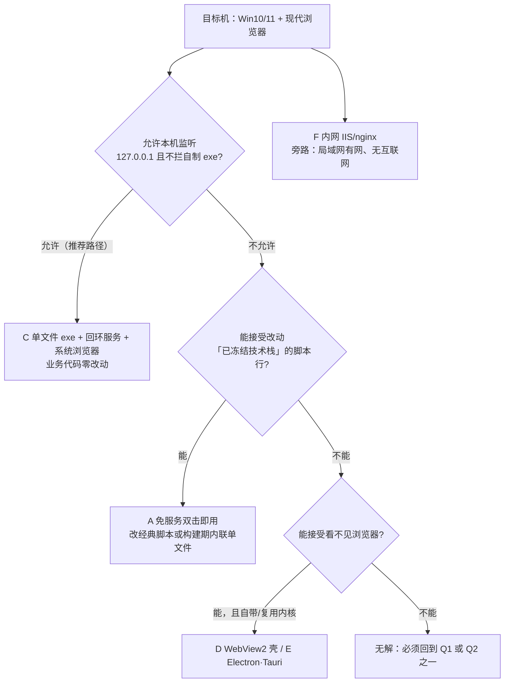

# 离线运行与打包方案评估（Windows · 无网络 · 免依赖）

> **本文档是「评估 + 实施记录」**：回答「要让本工具箱在其他 Windows 设备上**无网络**、且目标机**可能没有任何
> 相关依赖**时也能运行，需要额外调整哪些部分、有哪些运行或打包安装方案」。
> **状态（v1.7.21）**：评估已完成并采纳全部决策（见 §9）；**方案 C 的 csc 变体已实施并通过本机实测**
> ——离线单文件 exe（`scripts/build-portable.ps1` → `dist/toolbox.exe`，约 248 KB，内嵌整份站点，
> 固定端口 5183 + 单实例复用 + `--app` 独立窗口）。A/D/E/F 未实施（A 需改动 §2.1，属 D 级）。
> 后续落地方案仍须按 `docs/DESIGN.md` 文档头的纪律（§1.2 红线、§11.1 变更分级）先更新设计文档并写明理由。

- 评估对象：本仓库当前版本（`docs/DESIGN.md` 文档版本 1.7.21，最近更新 2026-10-15）
- 目标环境（据需求澄清）：Windows 10/11，目标机自带 Edge/Chrome（现代浏览器齐全，WebView2 大概率在）
- 目标介质（据需求澄清）：U 盘/共享盘绿色包、单个 exe、msi/exe 安装包
- 结论：**推荐 C（单文件 exe 内嵌静态资源 + 本机回环服务 + 系统默认浏览器）**；备选 **A（`file://` 免服务双击）**；D/E 仅在「不能让用户看到浏览器」时考虑
- 相关位置：`docs/DESIGN.md`（设计基准）、`README.md`「## 部署」（`README.md:447-462`）、`README.md:387`（既有说明：**不能直接双击 HTML**，因为 ES Module 需要 HTTP 环境）

---

## 0. 结论摘要

1. **产品本体已经天然离线**：全仓运行期**零外部请求**（无 CDN、无外链字体、无图标库、无埋点），图标是内联 SVG，favicon 是内联 data URI，运行期**没有 `fetch` / `XMLHttpRequest` / `WebSocket`**，也**没有** Service Worker、`Worker`、`crypto.*`、File System Access API。也就是说：**只要用「本机 HTTP」打开，它在完全无网络的机器上就能完整工作**（这本就是 R2/R3 的设计结果）。
2. **唯一的硬阻塞是加载协议**：入口页与 5 个工具页都用 `<script type="module">`（`index.html:148`、`tools/*/index.html` 各一），工具模块还用 `await import()` 惰性加载（`assets/js/shell.js:433`）。ES Module 在 `file://` 下会被浏览器按跨源规则拒绝（opaque origin）→ **双击 `index.html` 当前必然不可用**。这一点 `README.md:387` 已经明确告知用户。
3. **三条路线**：
   - **C（推荐）**：把静态目录塞进**一个 exe**（Go `embed`，或等价方案），双击后在本机 `127.0.0.1` 起一个**只读静态分发器**并自动打开系统默认浏览器。**业务代码零改动**，渲染与 JS 全交给系统 Edge/Chrome。
   - **A（备选）**：不做服务，直接把脚本加载形态从 ESM 改成经典脚本（或构建期内联为单文件），做到**双击即用**。代价是触碰「已冻结技术栈」的脚本行（`docs/DESIGN.md:522`）与 R4 的表述，属于需要所有者批准的设计变更。
   - **D/E（仅在必须自带/隐藏内核时）**：WebView2 壳或 Electron/Tauri。**从性能角度看是纯亏**（见 §7.2），只在「用户不能看到浏览器」这类非性能诉求下才值得 —— 且 v1.7.20 增补的 **`--app` 应用模式**（§4.C）已用**零开发成本**满足这一诉求，D/E 的适用面进一步收窄。
4. **落地组合（实际推荐）**：**C + `--app` 应用模式 + 固定端口单实例复用 + 配置导出/导入**（细节见 §4.C「C+ 推荐组合」）。要点：exe 固定端口起本机分发器 → 探测到已有实例就直接复用 → 用 Edge/Chrome 原生 `--app` 以**无地址栏独立窗口**打开（观感即桌面应用，零开发）。
5. **介质怎么选**：**介质（绿色包 / 单 exe / msi）本身不改变运行性能** —— 三种最终跑的都是同一份 763 KB 静态资源（实测）。差异只在首次部署成本、**U 盘直达时的读盘模式**（单文件顺序读 vs 散目录随机读＋逐文件扫描）与管理员权限/策略拦截概率。因此：**取「单个 exe（绿色、免安装）」**；msi 只在批量装机、需要开始菜单/卸载项时追加，它是同一个 exe 的外包装（受管环境下配合代码签名，见 §4.C「分发双轨」）。
6. **本机实测（可复现，2026-10-15）**：产品静态资源 **36 个文件 / 781,040 字节（763 KB）**（`assets/` 164 KB + `tools/` 591 KB + `index.html` 7 KB）；入口页首屏共 **15 个本地文件**（1 个 HTML + 5 个 CSS + 9 个 JS），**排除文档本身为 14 个同源请求**，无任何第三方 URL（命令见 §7.3）。

---

## 1. 现状判定

### 1.1 已经具备的离线能力（代码事实 / 实测）

| 能力 | 证据 | 说明 |
| --- | --- | --- |
| 运行期零网络 | `assets/js/**` 检索 `https?://`、`fetch(`、`XMLHttpRequest`、`WebSocket` → **0 命中** | R2 的既有成果，离线可跑的前提 |
| 零第三方资源 | 全仓 HTML/CSS/JS 无 CDN/外链字体/图标库引用（`https?://` 与 `cdn`/`fonts.`/`unpkg`/`jsdelivr` → 0 命中） | R3 的既有成果 |
| 图标内联 SVG | `assets/js/icons.js` | 无图标字体/图标库文件 |
| favicon 无请求 | `index.html:15`（`data:image/svg+xml,...`） | 首屏 0 额外请求 |
| 路径相对解析 | `assets/js/shell.js:37`（`SITE_ROOT = new URL("../../", import.meta.url)`）、`:40-42`（`toSiteUrl`） | 天然兼容子路径、任意盘符、含中文/空格的目录（`README.md:440-445` 为同一约定） |
| 剪贴板可降级 | `assets/js/utils/clipboard.js:17-18`（`navigator.clipboard` + `isSecureContext`）、`:40`（`document.execCommand("copy")`）、`:54-55`（读取同守卫） | 非安全上下文自动降级为 `execCommand`（模块注释 `clipboard.js:4-5` 自述） |
| 无高危/受限 API | `Worker`/`SharedWorker`/`serviceWorker`、`crypto.*`、`showOpenFilePicker`/`showSaveFilePicker`/`FileSystemFileHandle`、`history.pushState`、`location.assign`、`location.href =`、`structuredClone`、`requestIdleCallback` → **全部 0 命中** | `file://` 下的风险面很小 |
| 加载失败有可读兜底 | `assets/js/shell.js:379-387`（`renderBlockError`）、`:428-455`（`loadToolModule` 抛错）、`:470-476`（独立页 catch）、`:554`（标签模式复用同一兜底）；`index.html:28-33` 的 `<noscript>` | 对应 `docs/DESIGN.md:510`「§1.3 渐进增强」 |
| 无构建/无 CI | 全仓无 `vite/webpack/rollup/tsconfig`、无 `.github/workflows`、无 `*.yml`、`*.json` 仅 `package.json`、无 `manifest.json`、无 SW 注册 | 纯静态目录可直接拷贝 |
| 工具齐备 | `assets/js/registry.js:39-95`，5 个工具 `status` 全为 `"ready"` | 离线包与在线版本功能一致 |

### 1.2 阻塞项

| 阻塞项 | 证据 | 后果 | 影响的方案 |
| --- | --- | --- | --- |
| ES Module 在 `file://` 被拒 | `index.html:148`；`tools/*/index.html` 各一处模块脚本；`assets/js/shell.js:433` 动态 `import()` | **双击 `index.html` 不可用**；只有静态 HTML 可读（`#shell-root` 空、`#tool-grid` 空） | A（必须改造）；B/C/D/E/F 不受影响 |
| 工具模块惰性动态 import | `assets/js/shell.js:433`（`await import(/* @vite-ignore */ toSiteUrl(tool.entry))`）；`assets/js/tabs.js:662` 注释说明走 `loadTool` 回调（`shell.js:552-553`） | 与上同源：任何「免服务」形态都必须解决它 | A |
| 工具独立页无条件跳转 | `assets/js/tool-redirect.js:20-25`（`location.replace` 到 `../../index.html#/<id>`），`:8-9` 注释禁止改用 `<meta refresh>` | `file://` 下会跳到标签工作台再遭遇模块加载失败；单击工具页等于死路 | A |
| 预览脚本依赖 `npx` | `package.json:9-13`（`dev`/`start`/`preview` 全为 `npx --yes serve -l 5173 .`）、`:14-16`（`node >= 18`） | 离线设备无法拉起预览（`npx` 需网络；仓库无 lockfile，`.gitignore:5` 忽略 `package-lock.json`） | 所有方案（本地预览方式） |
| ~~无离线部署文档~~（v1.7.19 已补） | `README.md:447-469`：「部署」原有 CloudBase 与 GitHub Pages（均需网络），现新增「无网络 / 内网 / U 盘」小节指向本文档 | 此前用户不知道「拷到 U 盘怎么办」；已有入口 | 所有方案 |
| 存储隔离会「看起来丢数据」 | `toolbox:tabs`（`tabs.js:291,301`）、`toolbox:sidebar`（`shell.js:74,84`）、工具配置键（如 `formula-calc.js:65,76`） | `file://` 按**文件路径**分区、`http://127.0.0.1:<端口>` 按 **origin（含端口）** 分区 ⇒ 换形态/换端口后标签布局与《公式计算器》历史不延续 | A（换路径即变）；B/C（换端口即变） |

### 1.3 待目标机确认项（**未实测，不写成结论**）

| 待确认 | 为什么重要 | 确认方法 |
| --- | --- | --- |
| `file://` 是否被判为「安全上下文」 | 决定 A 方案下剪贴板走 `navigator.clipboard` 还是降级 `execCommand`（两者都可用，但体验不同） | 目标机打开任意本地 HTML，控制台执行 `window.isSecureContext` |
| `file://` 下 `localStorage` 是否可用、是否跨目录共享 | 决定 A 方案下「布局记忆/公式历史」是否保留 | 目标机双击同一目录下的两个 HTML，比较 `localStorage` 可见性 |
| `file://` 下 `<a download>` 与 `<input type=file>`/`FileReader`（拖入文件）是否受限 | 影响 4 个工具的导出/导入能力（`text-line-merge.js:629,644`、`sql-format.js:1830,1845`、`date-calc.js:1006,1021`、`formula-calc.js:1467,1481`） | 目标机在 `file://` 页面里各点一次导出/导入 |
| 目标机是否装有 WebView2 运行时 | 决定 D 方案是否需要随包分发运行时 | 查注册表 `HKLM\SOFTWARE\WOW6432Node\Microsoft\EdgeUpdate\Clients\{F3017226-FE2A-4295-8BDF-00C3A9A7E4C5}` 的 `pv` 值，或直接跑一次 WebView2 宿主 |
| 企业策略是否禁止本机监听端口 / 拦截 `.ps1` / 拦截自制 exe | 决定 B/C 能否用、是否需要退到 A | 目标机以普通用户运行最小样例（`TcpListener` 监听 127.0.0.1）并观察安全软件告警 |
| PowerShell 启动与脚本执行策略 | B 方案下 `-ExecutionPolicy Bypass` 仍可能被组策略覆盖 | 目标机 `Get-ExecutionPolicy -List` |

---

## 2. 路线决策图



---

## 3. 方案矩阵（九维）

> 性能不在本表展开（避免表格过宽），专见 §7。表中「体积」为同一口径：产品静态资源实测 763 KB。

| 方案 | 体积 | 目标机依赖 | 改造量（文件级） | U 盘中文/空格/盘符变化 | localStorage 迁移影响 | Win10/11 适配 | 权限与杀软风险 | 可自动化验证方式 | 与 R1–R7 冲突点 | 实施工作量 | 长期维护成本 |
| --- | --- | --- | --- | --- | --- | --- | --- | --- | --- | --- | --- |
| **A 免服务双击** | 763 KB（多文件）或 ~1 MB（内联单文件） | 仅现代浏览器 | 高：`index.html` + 5 个工具页 + `assets/js/*`（10 个）+ `tool-redirect.js` ≈ 17 个文件；需处理 `import()`、`SITE_ROOT`、工具页跳转 | 好（相对路径 + `new URL` 已兼容；但 `file://` 存储按路径分区） | 换目录/换盘符即「丢」布局与公式历史（需文档说明或导出导入兜底） | 好（现代 Edge/Chrome 均可，`file://` 无网络需求） | 最低（无进程、无端口、免管理员） | 无头 Edge `--headless=new --dump-dom` 驱动真实页面断言（需先关闭 `--allow-file-access-from-files` 之外的特殊开关，按默认策略测） | **触碰 `§2.1` 脚本行与 R4 表述**（属 D 级设计变更） | 中（≈17 文件的加载形态改造） | 高（若同时保留在线 ESM 形态，长期维护两套加载路径） |
| **B 便携启动器（应急）** | 763 KB + 一个 `.ps1`/`.cmd`（几 KB） | Windows 自带 PowerShell（免安装） | 低：新增 `tools/serve.ps1` + `启动.cmd`；产品代码 0 改动 | 好（`$PSScriptRoot` + URL 解码处理中文/空格） | 端口固定则稳定；端口随机则每次「丢」（可固定端口规避） | 好 | 中：可能被执行策略拦截、被安全软件告警（自写监听端口）；免管理员（用 `TcpListener` 而非 `HttpListener`） | 无头浏览器访问 `http://127.0.0.1:<port>/` 跑同一套断言 | R1 的「零后端」需口径澄清：该进程只是**静态分发器**，无业务逻辑、不落数据 | 中（健壮的 HTTP 语义要自己实现：keep-alive / 并发 / 大文件 / MIME） | 中（执行策略与杀软环境变化要跟） |
| **C 单文件 exe（推荐）** | 量级 5–10 MB（含 763 KB 资源 + Go 运行时；**待实测**） | 无（单文件；用系统浏览器） | 低：新增构建脚本 + `main.go`；产品代码 0 改动 | 好（顺序读单个文件，且不依赖相对路径解析） | 固定端口 + 单实例复用则跨次稳定（§4.C「C+」） | 好 | 低：免管理员、不写注册表；自编译 exe 可能被安全软件质疑（可留构建脚本供复核；企业分发走签名 + msi，见 §4.C「分发双轨」） | 同 B（静态分发器口径） | R1 的「零后端」需口径澄清：该进程只是**静态分发器**，无业务逻辑、不落数据 | 低（`main.go` 约 100 行 + 复制脚本 + 一次构建） | 低（发新版 = 重新构建；无运行时依赖需要跟进） |
| **D WebView2 壳** | 宿主几 MB；若需离线分发固定版运行时 ≈ 130 MB 量级（**待实测**） | WebView2 运行时（Win10/11 通常随 Edge 具备） | 中：新增宿主工程（C#/Go/C++）+ 运行时检测与提示 | 好 | 与 B/C 同：origin 为 `http://127.0.0.1:<port>`（或自定义协议，需另行设计） | 好（依赖系统 WebView2 版本） | 中：首次可能触发运行时缺失提示；安装运行库需网络或随包 | 宿主内可用 WebView2 的自动化（CDP）驱动断言 | 同 B；另需说明「自带宿主」不等于「自带内核」 | 中高 | 中（跟随 WebView2 运行时版本） |
| **E Electron / Tauri** | Electron 量级 100–250 MB；Tauri 量级 5–10 MB（**均待实测**） | Electron 无（自带 Chromium）；Tauri 需 WebView2 + 构建机 Rust | 中高：新增打包工程与产物分发流程 | 好 | Electron 的 origin 可控（自定义协议/本地服务），可做到跨机一致 | 好 | 中：大体积 exe 易被安全软件扫描拖慢；企业白名单需逐个登记 | Electron 支持 Playwright/CDP；Tauri 有官方测试接口 | 同 B；另：R4「零构建」需明确指的是**运行期** | 高（Electron）/ 中高（Tauri，需 Rust 工具链） | 高（Electron 大版本与安全补丁跟进）/ 中（Tauri） |
| **F 内网 IIS/nginx** | 0（复用现有静态托管） | 局域网内有服务器 | 极低：上传目录即可（保持相对结构） | 不适用（不经 U 盘） | 稳定（origin 固定） | 好 | 低 | 与服务上跑同一套端到端断言 | 无（在线形态，无新进程） | 极低 | 低（依赖内网服务器运维） |

---

## 4. 各方案细则

### A. 免服务「双击即用」

- **适合谁**：目标机**不允许任何本机监听进程**、或希望「拷进 U 盘、双击就用、不留任何进程」。
- **改造量**：约 17 个文件（见 §3 表）。两条子路线：
  - **A1 直接去 ESM**（保留多文件目录）：
    1. `assets/js/*.js`（10 个）的 `export`/`import` 改为**经典脚本 + 单一全局命名空间**（如 `window.Toolbox = { … }`），脚本间通过全局对象引用；
    2. `index.html:148` 与 5 个 `tools/*/index.html` 的模块脚本改为 `<script defer src="…"></script>`，并按依赖顺序补齐被导入的模块（`registry → icons → utils/dom → utils/clipboard → utils/text → theme → tabs → shell`）；
    3. `assets/js/shell.js:433` 的 `await import(…)` 改为**动态插入 `<script>` + `onload`/`onerror`**（保留「惰性挂载 + 加载失败可读提示」的语义）；
    4. `assets/js/shell.js:37` 的 `SITE_ROOT` 改为 `new URL("./", document.baseURI)`（`import.meta.url` 在经典脚本中不可用）；
    5. `assets/js/tool-redirect.js:20-25` 增加 `location.protocol === "file:"` 分支：不再跳转（或跳转后确保模块能加载），保证工具独立页在 `file://` 下仍可读（§1.3 渐进增强）。
  - **A2 构建期内联单文件**（若选 A，**推荐这条**）：新增零依赖构建脚本（`tools/build-offline.mjs`，Node）把 CSS/JS 按顺序内联为一个 HTML（或每工具一份），产物放 `dist/`（`.gitignore:11-13` 已忽略）。注意：**A2 仍然需要 A1 的第 3/4/5 步**（内联后 `import.meta.url` 与动态 `import()` 同样不可用），只是源码形态不变、产物是单文件。
- **步骤（A2 概要）**：
  ```bash
  node tools/build-offline.mjs      # 读 index.html → 按 <link>/<script> 顺序内联 → 写 dist/Toolbox.html
  # 产物拷到 U 盘任意目录（含中文/空格）→ 双击 → 逐工具点检
  ```
- **风险与规避**：
  - 双形态维护成本：若仍要保留在线形态（ESM），就必须长期维护两套加载方式 → 建议**只选一条**（这也是 A 被列为「备选」的原因）。
  - 内联后单文件体积 ≈ 763 KB（未压缩），不影响本机打开速度。
  - `file://` 下能力边界（剪贴板首选路径、存储隔离、导出/导入）见 §1.3，**必须逐项在目标机确认**。
- **验收**：见 §8。

### B. 便携启动器（PowerShell 本地服务）

- **适合谁**：接受「双击一个 `.cmd` 启动、用浏览器访问」的方式，且要**产品代码零改动**。
- **定位（v1.7.20 修订）**：**应急手段**。PowerShell 手写 HTTP 要自己处理 keep-alive / 并发 / 大文件 / MIME；企业环境的执行策略、AMSI、WDAC 还可能直接拦截脚本。正式分发请直接走 **C**，B 只在「一行脚本应急」或目标机禁止运行任何 exe 时使用。
- **改造量**：新增 2 个文件（`tools/serve.ps1` + 启动 `.cmd`），产品代码 0 改动。
- **关键设计点**：
  - **用 `TcpListener` 手写极简静态分发器，不用 `HttpListener`**：`http://localhost:<port>/` 前缀在 Windows 上通常需要管理员权限或 URL ACL，而 `TcpListener` 绑定 `127.0.0.1` 不需要（这是「免管理员」的关键）。
  - 只绑定回环地址（`127.0.0.1`），**不监听外网**；只服务 `$PSScriptRoot` 下的文件；**路径规范化 + 前缀校验**防目录穿越；`Content-Type` 白名单（`.html/.css/.js/.json/.svg/.ico/.map`）。
  - URL 解码要用 `[uri]::UnescapeDataString`，以覆盖**中文/空格目录**；固定端口（如 5183）以便 localStorage 稳定，占用时顺延并在提示中说明「地址变了会看不到之前的标签布局」。
  - 启动后自动打开浏览器：`Start-Process "http://127.0.0.1:<port>/"`。
- **步骤**：
  ```bat
  @echo off
  powershell -NoProfile -ExecutionPolicy Bypass -File "%~dp0serve.ps1"
  ```
  ```powershell
  # serve.ps1 关键骨架（完整实现由后续落地时补全）
  $root = $PSScriptRoot
  $port = 5183
  $listener = [System.Net.Sockets.TcpListener]::new([System.Net.IPAddress]::Loopback, $port)
  $listener.Start()
  Start-Process "http://127.0.0.1:$port/"
  while ($true) {
    $client = $listener.AcceptTcpClient()
    # 读请求行 → 取路径 → [uri]::UnescapeDataString → 规范化 → 前缀校验 → 读文件 → 回 Content-Type/Content-Length
  }
  ```
- **风险与规避**：

  | 风险 | 规避 |
  | --- | --- |
  | 执行策略被组策略锁定（`Bypass` 也会被拒） | 目标机先跑 `Get-ExecutionPolicy -List` 确认；不行则退 C 或 A |
  | 安全软件对「脚本开监听端口」告警 | 只绑 `127.0.0.1`、只读文件、无外联；在文档里写明行为，必要时走白名单 |
  | 从 U 盘直接运行慢/被拦 | 建议先拷到本地磁盘再运行（同时端口/路径稳定） |
  | 端口被占用 | 顺延端口并给出提示；说明「换端口 = 换存储 origin」 |
  | PowerShell 启动耗时 | 量级 数百 ms（**待实测**）；可改用 C |
- **不选它而选 C 的理由**：C 把同样的分发器换成原生单文件 exe，去掉「执行策略/被杀软怀疑脚本」这一类不确定性，体积代价只有几 MB。

### C. 单文件 exe 内嵌静态资源（推荐）

- **适合谁**：**默认推荐** —— 目标机 Win10/11 + 现代浏览器、要求「拷一个文件、双击就用」、不要安装、不要管理员。
- **改造量**：新增（不入库即不污染产品树）三个文件：构建脚本（把产品静态树复制到 `web/`）、`main.go`、可选的图标/版本信息文件；**产品代码 0 改动**。
- **步骤（开发机一次构建，目标机零依赖）**：
  ```bash
  # 1) 准备静态目录（只含产品文件，排除 docs/.tmp/.git）
  #    可用 PowerShell 或 Node 脚本复制：index.html、assets/**、tools/**
  # 2) 构建（Go 1.21+；-H=windowsgui 必加，否则每次双击都会常驻一个控制台黑窗）
  go build -trimpath -ldflags "-s -w -H=windowsgui" -o dist/toolbox.exe
  ```
  ```go
  // main.go 关键骨架（v1.7.20 增补：固定端口 / 单实例复用 / --app 打开）
  //go:embed all:web
  var assets embed.FS

  const port = 5183 // 固定端口：localStorage 按 origin（含端口）分区，端口一变布局与历史就「丢」

  func main() {
      sub, _ := fs.Sub(assets, "web")
      url := fmt.Sprintf("http://127.0.0.1:%d/", port)
      if alreadyServing(url) { // GET /__healthz 并校验特征：已有实例在跑 → 直接复用，不起新进程
          open(url)
          return
      }
      ln, err := net.Listen("tcp", "127.0.0.1:5183")
      if err != nil {
          // 端口被**其它程序**占用：明确提示并退出，不要静默换端口（换端口 = 换存储 origin）
          return
      }
      mux := http.NewServeMux()
      mux.HandleFunc("/__healthz", func(w http.ResponseWriter, _ *http.Request) { w.Write([]byte("toolbox")) })
      mux.Handle("/", noCache(http.FileServer(http.FS(sub)))) // no-store：升级后不得命中旧缓存
      go open(url)
      http.Serve(ln, mux)
  }

  // open：三级回退。--app（无地址栏独立窗口，观感即桌面应用）→ 普通标签页 → 仅打印 URL
  func open(url string) {
      for _, exe := range []string{edgePath, chromePath} {
          if _, err := os.Stat(exe); err == nil {
              exec.Command(exe, "--app="+url, "--window-size=1280,860").Start()
              return
          }
      }
      exec.Command("rundll32", "url.dll,FileProtocolHandler", url).Start()
  }
  ```
  - 实现要点（v1.7.20）：`//go:embed` 的 FS **天然免疫目录穿越**（不用自己写路径校验）；MIME 由 `http.FileServer` 按扩展名给出（`.js` → `text/javascript`，模块才能执行）；`Cache-Control: no-store` 防升级后旧资源错配；固定端口 + `/__healthz` 探测实现**单实例语义**（见下）。
  - 体积量级 **5–10 MB**（含 763 KB 资源 + Go 运行时；**待实测**）。
  - 分发双轨（v1.7.20）：**个人用** = zip 或直接拷贝 exe（从未签名 exe 双击会触发 SmartScreen，选「仍要运行」即可；从网络下载的文件带 Mark-of-the-Web，可用 `Unblock-File` 解除）；**企业批量** = 代码签名 + msi（此时 msi 不是可选项，而是白名单/批量部署的必需品），构建脚本顺带输出 SHA-256 清单。
- **C+ 推荐组合（v1.7.20）：`--app` 应用模式 + 固定端口单实例 + 配置导出/导入**
  1. **`--app` 应用模式**：Edge/Chrome 原生支持 `--app=<url>` —— 独立窗口、无地址栏、无标签栏，**观感即桌面应用，零开发**。这直接消解了 D（WebView2 壳）/E（Electron）的主要动机；只有当产品必须**自带内核**（目标机连现代浏览器都没有）或必须**封装为单一安装包**时，才退回 D/E。
  2. **固定端口 + 单实例复用**：`localStorage` 按 origin（含端口）分区 —— 端口一变，标签布局与《公式计算器》历史就「看起来丢了」。因此**端口必须固定**；端口被占用时不要静默顺延，而是探测 `/__healthz`：是本工具在跑 → 直接复用（单实例语义）；是别的程序 → 明确报错。分发器进程**常驻**：关闭浏览器窗口不退出（二次启动秒级复用，不写自启、重启电脑即消失），彻底退出用任务管理器结束进程或 `taskkill /im toolbox.exe /f`。
  3. **配置导出/导入（外壳级）**：把标签布局（`toolbox:tabs`）+ 各工具配置 + 《公式计算器》历史合并为一份 JSON 导出/导入 —— 这是跨形态（file:// ↔ 服务）/跨机迁移的**唯一可靠兜底**（《公式计算器》已有导入导出可复用格式，§16.7）。属新功能，落地时按 §11.1 走 B 级流程。
  4. **升级路径**：覆盖 exe 即完成升级（数据在 localStorage，键迁移由外壳 `normalizeLayout` v1→v3 与公式历史 `version` 字段兼容）；验收见 §8 第 11 条。
- **实施记录（v1.7.21，csc 变体已落地）**：
  - `packaging/csharp/Server.cs`（C# 5，目标 .NET Framework 4.x，由系统 csc.exe 编译 `/target:winexe`）：单实例探测（`/__healthz` 应答 `toolbox`）→ 固定端口 5183 只读分发（内嵌 zip、键值匹配免疫目录穿越）→ `--app` 三级回退打开；windowsgui（无双击黑窗）；致命错误用 MessageBox 表达（§1.3 不出现不可读失败）。
  - `scripts/build-portable.ps1`：复制产品树 → `Compress-Archive` → csc → `dist/toolbox.exe` + SHA-256。**注意**：`.ps1` 含中文，必须保存为 UTF-8 with BOM（PS 5.1 无 BOM 会按 ANSI 解析）；`Server.cs` 由 csc 参数 `/codepage:65001` 处理。
  - **实测（本机）**：exe **248 KB**（253,440 字节）；`/`、`/__healthz`、`/assets/js/shell.js`（`text/javascript`）、404 均正确；第二实例 **1.2 s 内**探测复用退出（进程数保持 1）；`--path-as-is` 目录穿越 404；**真实应用从该服务完整启动**（无头 Chromium：5 工具注册、外壳渲染正常）。
  - Go 变体为**同契约的后续可选替换**（构建机无 Go 不是阻塞项）。
- **无 Go 环境时的替代**：Windows 自带 `%WINDIR%\Microsoft.NET\Framework64\v4.0.30319\csc.exe`，可在**目标机现场编译**一个 C# 版本（`TcpListener` 手写分发器，逻辑同 B）。局限：C# 语言版本低、首次编译耗时、安全软件对「现场编译产物」更敏感、需要在每台机器上重复编译 —— **只作应急手段**。
- **风险与规避**：

  | 风险 | 规避 |
  | --- | --- |
  | 自制 exe 被安全软件质疑 | 源码与构建脚本入库（可复核）；如企业要求，附一份构建说明或哈希清单 |
  | 随机端口导致每次「看不到之前的标签布局」 | 提供固定端口开关；在启动参数与 README 中说明存储按 origin 分区 |
  | 目标机没有默认浏览器 | Win10/11 必有；若被策略移除，回退到「手动打开打印出的 URL」 |
  | 需要「安装到开始菜单」时 | 追加 msi/NSIS 包装（同一 exe，性能不变） |
- **验收**：见 §8（断网 + U 盘直达 + 逐工具点检 + 存储与剪贴板核对）。

### D. WebView2 壳

- **适合谁**：**必须让用户看不到浏览器**，且接受「宿主 + 系统运行时」的复杂度。
- **改造量**：新增宿主工程（C#/Go/C++）+ 运行时检测与缺失提示；产品代码 0 改动。
- **要点**：
  - 运行时检测：读注册表 `HKLM\SOFTWARE\WOW6432Node\Microsoft\EdgeUpdate\Clients\{F3017226-FE2A-4295-8BDF-00C3A9A7E4C5}` 的 `pv`（**需在目标机确认**是否存在）。
  - 缺失时的选择：Evergreen Bootstrapper（体积小，**需要联网**）× 离线场景不可用；Fixed Version 运行时（可离线分发，**体积 ≈130 MB 量级**，待实测）—— 等于用另一种方式付体积。
  - 仍然建议**内部起本地回环服务**或使用自定义协议承载静态资源（WebView2 对 `file://` 的限制与浏览器一致）。
- **与 C 的取舍（v1.7.20）**：性能上没有收益（见 §7.2），多出宿主初始化与运行时依赖。**先看 §4.C 的 `--app` 模式**——它以零开发给出同样的「独立窗口」观感；D 只在需要**打包成单一安装产品、目标机没有可用浏览器、或 `--app` 被策略禁止**时才考虑。

### E. Electron / Tauri

- **适合谁**：需要**完全自带内核**（Electron）或「小而现代的桌面壳」（Tauri），且愿意承担构建链与分发体积。
- **要点**：
  - Electron：自带 Chromium，体积量级 100–250 MB（**待实测**），冷启动与内存占用明显高于「系统浏览器 + 回环服务」；构建链为 Node + electron-builder/forge，可产出 portable exe 或 NSIS 安装包。
  - Tauri：复用系统 WebView2，体积量级 5–10 MB（**待实测**），但构建机需要 Rust 工具链，目标机需要 WebView2 运行时（与 D 同）。
  - 两者的 JS 引擎与系统浏览器同为 Chromium/V8（Tauri 在 Windows 上即 WebView2）⇒ **计算性能不会更好**，差异只在启动与内存。
- **结论**：在「目标机自带现代浏览器」这一前提下，**不建议**为性能选 E。v1.7.20：`--app` 模式进一步压缩其适用面 —— 仅当「必须自带内核」时保留。

### F. 内网 IIS / nginx 静态托管

- **适合谁**：局域网有服务器、只是**没有互联网**的场景（严格来说不属于「单机离线」，但是最省事的旁路）。
- **要点**：
  - 上传整个产品目录并**保持相对结构**（`index.html`、`assets/`、`tools/`）；路径是相对解析（`README.md:440-445`），根路径或子路径皆可。
  - **`Content-Type` 必须正确**：`.js` 若被服务器报错为 `text/plain`，浏览器会拒绝执行模块（这是最常见的「部署成功但白屏」原因）。
  - `.nojekyll` 只对 GitHub Pages 有意义（`README.md:460`），对 IIS/nginx 无影响。
  - hash 直链（`#/<工具 id>`）由浏览器处理，静态托管无需重写规则（`README.md:454-455` 已述）。

---

## 5. 分级改造清单

> 「必须改 / 建议改 / 可选增强」按**所选方案**判定；每条给出「文件 → 位置 → 改法 → 为什么」。

### 5.1 必须改（取决于路线）

| 若选 | 文件 | 位置 | 改法 | 为什么 |
| --- | --- | --- | --- | --- |
| A | `assets/js/shell.js` | `:37` | `SITE_ROOT` 改为 `new URL("./", document.baseURI)` | 经典脚本里没有 `import.meta.url` |
| A | `assets/js/shell.js` | `:433` | `await import()` 改为动态 `<script>` 加载（保留 `onerror` → `renderBlockError`） | `file://` 下动态模块导入同样被拒 |
| A | `assets/js/*.js`（10 个） | 各文件 `export`/`import` | 改为经典脚本 + 单一全局命名空间 | 去掉模块语义才能免服务 |
| A | `index.html`、5× `tools/*/index.html` | 模块脚本行 | `<script type="module">` → `<script defer>` 并按依赖排序 | 同上 |
| A | `assets/js/tool-redirect.js` | `:20-25` | 增 `file:` 分支（不跳转或跳转后仍可读） | 否则工具独立页在 `file://` 下必然空白 |
| A | `docs/DESIGN.md` | `:465`（§2.1 脚本行）、`:441`（R4） | 更新技术栈表述并写明理由（**D 级**） | 文档头纪律：先改设计文档再改代码 |
| B / C / D / E | 新增启动器/构建脚本 | — | 见 §4.B / §4.C | 产品代码不必改，但交付物需要它 |
| B / C / D / E | `docs/DESIGN.md` | R1 口径 | 写明「交付期本地静态分发器」与「产品后端」的区别 | 避免与 R1「零后端」被误判为冲突 |
| 任意 | `README.md` | `:447-462`（## 部署） | 新增「无网络 / 内网 / U 盘」小节并指向本文档 | 现有部署章节只有两份在线托管方案 |

### 5.2 建议改（与方案无关）

| 文件 | 位置 | 改法 | 为什么 |
| --- | --- | --- | --- |
| `package.json` | `:9-13` | 增加一个**不联网**的本地预览方式（如 `python -m http.server` 或仓库内零依赖 Node 脚本），保留 `npx` 版本作为备选 | 离线机器上 `npx serve` 拉不起来（需网络 + Node） |
| `README.md` | `:387` 附近 | 在「不能直接双击 HTML」的说明后补一句「离线怎么用」（指向本文档第 0 节推荐路线） | 这是用户最容易踩的一步 |
| `assets/js/shell.js` | `:379-387`、`:470-476` | 检查模块加载失败时的提示文案是否覆盖「`file://` 被拒」这种场景（当前展示的是浏览器给出的原始错误） | §1.3 要求「可读错误提示」 |
| `.gitignore` | `:11-13` | 保持现状（`dist/`、`build/` 已忽略）；若决定把产物入库再显式放行 | 产物入库与否是决策，不是默认 |

### 5.3 可选增强

| 项 | 位置 | 说明 |
| --- | --- | --- |
| 外壳级「配置导出/导入」（v1.7.20 升格） | `assets/js/tabs.js`（`toolbox:tabs` 读写处 `:291,301`）+ 新增外壳入口 | 把**标签布局 + 各工具配置 + 《公式计算器》历史**合并为一份 JSON 导出/导入 —— 跨形态（`file://` ↔ 服务）/跨机迁移的**唯一可靠兜底**（《公式计算器》已有导入导出，可复用格式；属新功能，按 §11.1 走 B 级流程） |
| 离线包自检清单 | 新增（文档） | 交付前对 U 盘包做一遍 §8 的检查项，避免「到现场才发现打不开」 |
| 构建产物校验 | 新增（脚本） | 记录 exe 的 SHA-256 与构建时间，便于企业白名单登记与事后复核 |
| 端口固定策略 | 启动器/宿主 | 固定端口让 localStorage 跨次稳定；冲突时按「单实例复用」处理（§4.C「C+」），**不得静默换端口** |
| Service Worker 预缓存（记录为**不做**，v1.7.20） | — | SW 只在安全上下文生效（`127.0.0.1` 可用、`file://` 不可用），并引入「更新时效 / 缓存失效」的长期复杂度；离线形态的可用性并不依赖它，收益不抵复杂度，故明确不做 |

---

## 6. 约束变更登记（与 R1–R7 的关系）

| 红线（`docs/DESIGN.md:495-502`） | 本评估的方案是否触碰 | 口径 |
| --- | --- | --- |
| R1 零后端 | B/C/D/E 会**在目标机**运行一个**只读静态分发器** | 「产品」不含任何服务端逻辑、接口与环境变量这一条**不变**；分发器只按路径返回磁盘/内嵌文件，无业务逻辑、不接收用户数据、不写任何存储。建议在 §1.2 或 §2.1 处显式写明这一区分 |
| R2 零网络请求 | 否 | 产品运行期仍零外部请求；回环 `127.0.0.1` 属于本机进程间通信，不出设备、不入公网 |
| R3 零第三方资源 | 否 | 六个方案都不引入 CDN/框架/字体；A2 的内联脚本是仓库自有代码 |
| R4 零构建 | **表述上需要澄清** | 「**运行期**零构建、零依赖、浏览器直接执行源码」保持不变；「交付期做一次性打包/内联」是运维动作（产物不入库、源码形态不变）。建议在 §2.1 旁加一句口径说明 |
| R5 输入不落盘 | 否 | 唯一落盘例外仍是《公式计算器》历史（`formula-calc.js:65,76`）；离线形态不新增键。**但**换 origin 会让既有历史「看起来消失」，需在文档提示 |
| R6 工具解耦 | 否 | 方案不改工具契约；A1 的全局命名空间属于**加载形态**改变，仍保持「工具模块只导出 `init(ctx)`」的契约 |
| R7 参数化优先 | 否 | 本评估不新增功能行为 |
| §2.1「脚本 = 原生 ES Module」（`:465`） | **A 方案触碰** | A 必须把脚本行改为「经典脚本（或双形态）」→ 属**已冻结技术栈**的变更，需所有者批准并在 DESIGN.md 写明理由；B/C/D/E/F 不触碰 |

**决策建议（待所有者拍板，见 §9）**：

1. 建议把 R4 的口径写死为「**运行期**零构建零依赖；交付期允许一次性打包，产物不入库」。
2. 建议**构建脚本入库、产物不入库**（`.gitignore:11-13` 已忽略 `dist/`、`build/`，无需改动）。
3. 若选 A，则必须接受 §2.1 脚本行的变更（D 级）。

---

## 7. 性能基准与实测口径

### 7.1 介质取舍（结论先行）

| 介质 | 运行性能差异 | 首次部署成本 | 权限与策略风险 | 结论 |
| --- | --- | --- | --- | --- |
| 绿色压缩包（散文件目录） | **无**（跑的是同一份 763 KB 资源） | 解压即可 | 最低 | 适合内部分发；**U 盘直达时读盘模式最差**（多文件随机读 + 逐文件扫描） |
| 单个 exe（免安装） | **无** | 复制一个文件 | 低（不写注册表、免管理员） | **推荐**：U 盘直达为顺序读；「绿色包」本质上就是「zip 里放这一个 exe」 |
| msi / exe 安装包 | **无** | 需管理员安装 | 中（写注册表、企业白名单） | 仅批量装机、需要开始菜单/卸载项时，作为**同一个 exe** 的外包装追加 |

> 结论：**只选一种就选「绿色单 exe（免安装）」**。介质不改变运行性能，只改变「拷贝/安装成本」与「U 盘直达时的读盘模式」；若需要批量装机，再追加 msi 外包装。

### 7.2 形态取舍（推荐 C，备选 A）

| 方案 | 引擎 / 进程模型 | 冷启动 | 常驻内存 | 磁盘体积 | 说明 |
| --- | --- | --- | --- | --- | --- |
| A `file://` 免服务 | 系统 Edge/Chrome，**零额外进程** | 最快（量级：与打开本地 HTML 相当，**待实测**） | 仅浏览器本身 | **实测 763 KB**（36 文件） | 需改造脚本加载形态；`file://` 存储按路径分区 |
| **C 单文件 exe（推荐）** | 系统 Edge/Chrome + 一个回环分发进程 | 极快（多一个几 MB 进程的启动，**待实测**） | 浏览器 + 分发进程（量级 5–15 MB，**待实测**） | 量级 5–10 MB（**待实测**） | **业务代码零改动**；`127.0.0.1` 回环延迟可忽略 |
| D WebView2 壳 | 复用系统 Edge 内核 + 自研宿主 | 较慢（需初始化 WebView2，量级 数百 ms，**待实测**） | 与浏览器相当（多进程，量级 80–150 MB，**待实测**） | 宿主几 MB；离线运行时另计 | 性能无收益，只为「看不见浏览器」 |
| E Electron / Tauri | Electron 自带 Chromium / Tauri 复用 WebView2 | 最慢（量级 1–3 s，U 盘更慢，**待实测**） | 量级 100–300 MB（**待实测**） | Electron 量级 100–250 MB（**待实测**） | 与系统浏览器同为 V8，**JS 吞吐无优势** |

**为什么「用系统浏览器 + 回环服务」是最优解**：本工具的重活是纯 JS（大文本正则、差分、分词、公式求值），其吞吐由 V8 决定 —— 系统 Edge/Chrome、WebView2、Electron 都是同一引擎。真正的差别在**进程模型与体积**：零额外进程（A）> 几 MB 分发进程（C）> 宿主初始化（D）> 自带内核（E）。而 `127.0.0.1` 回环相对 `file://` 的额外成本是「每请求一次本机 TCP 往返」，量级远小于本机磁盘读；换来的是**避开 `file://` 的 origin/存储/API 限制**。

**离线场景独有的长期风险：浏览器冻结（v1.7.20）**。联网机器的 Edge/Chrome 会自动更新；**离线机器的浏览器版本冻结在交付时点**，随时间推移对新语法的支持逐步劣化。应对按序：① 交付时用尽量新的内核；② 产品保持语法保守（`color-mix` 等已有 `@supports` 兜底，§13.4/§13.5）；③ 若交付周期以年计，可随包捆绑 WebView2 Fixed Version 运行时（≈130 MB 量级，**待实测**）并让 exe 优先使用它 —— 此时 C 的一部分体积优势让渡给 D 的确定性。

### 7.3 四类指标与测量命令（可复现）

1. **冷启动到首屏**：页面内 `performance.now()` + `PerformanceObserver` 打点到 `DOMContentLoaded`/首屏可交互；或：
   ```powershell
   & "$env:ProgramFiles (x86)\Microsoft\Edge\Application\msedge.exe" --headless=new --disable-gpu `
     --user-data-dir="$env:TEMP\edge-perf" --virtual-time-budget=10000 --dump-dom `
     "http://127.0.0.1:5183/" > $null
   ```
   分别在**本地磁盘**与**U 盘直达**两种位置测同一形态，并记录「浏览器是否已在运行（热启动）」这一前提。
2. **常驻内存**：
   ```powershell
   Get-Process -Name toolbox | Select-Object Name,Id,WorkingSet64
   ```
   浏览器侧只统计本页面新增进程（浏览器常驻内存不计入本工具成本）。
3. **磁盘与拷贝体积**（本机已实测一条）：
   ```powershell
   Get-ChildItem -Recurse -File -Include *.html,*.css,*.js -Path index.html,assets,tools |
     Measure-Object Length -Sum            # → 36 个文件 / 781,040 字节（763 KB）
   Measure-Command { Copy-Item -Recurse .\dist\* E:\toolbox\ -Force }   # U 盘拷贝耗时
   ```
4. **典型工具端到端耗时**（性能的核心）：页面内用 `performance.now()` 包住重活 —— 《SQL 格式化》1 MB 脚本、《文本对比》1 万行、《公式计算器》数百行变量表；**同一份输入在各形态下对比**。
   预期结论（**待数据验证**）：引擎相同 ⇒ JS 吞吐基本一致，差异只出现在启动与内存。

### 7.4 已实测 / 待实测清单

| 项 | 状态 | 来源 |
| --- | --- | --- |
| 产品静态资源体积 763 KB / 36 文件 | **实测（2026-10-15）** | `Get-ChildItem … \| Measure-Object Length -Sum`（见 §7.3 第 3 条） |
| 入口页首屏 15 个本地文件（14 个同源请求） | **实测（静态分析）** | `index.html:20-24`、`:18`、`:148`、`assets/js/shell.js:16-29` |
| 零外部请求 / 零 `fetch` / 零 Worker / 零 SW | **实测（全仓检索，0 命中）** | 见 §1.1 |
| C 单 exe 体积 | **实测（v1.7.21，csc 变体）**：**248 KB**（253,440 字节，内嵌整站）——远小于 Go 路线的量级估计（csc 不捆绑运行时） | `Get-Item dist\toolbox.exe` |
| C 冷启动 / 常驻内存 | **待实测** | exe 已可运行，按 §7.3 第 1/2 条测 |
| 真实应用从分发器服务启动 | **实测（v1.7.21，无头 Chromium）**：5 工具注册、外壳渲染正常、模块脚本正常执行 | `--dump-dom http://127.0.0.1:5183/` |
| 单实例探测 / 目录穿越 | **实测（v1.7.21）**：第二实例 1.2 s 内复用退出（进程数保持 1）；`--path-as-is` 穿越 404 | §4.C「实施记录」 |
| A 方案在 `file://` 下的首屏与可用性 | **待实测** | 需先在目标机按 §1.3 逐项确认 |
| D/E 的体积、冷启动、内存 | **待实测** | 需构建产物 |
| 典型工具端到端耗时差异 | **待实测** | 用 §7.3 第 4 条的方法 |
| 目标机 SmartScreen / `--app` 观感 / U 盘直达 | **待实测（目标机）** | §1.3 的确认方法 |

---

## 8. 离线验收清单

> 交付前在**目标机**上按此表逐项打勾；未实测项不得写成结论。

1. **断网**：断开所有网络（含 Wi-Fi 与有线），确认工具仍可打开（浏览器地址栏为 `127.0.0.1` 或 `file://`）。
2. **路径健壮**：把包放在**含中文与空格**的目录（如 `D:\离线 工具\`）与**不同盘符**（C:/D:/E:）各跑一次；`file://` 形态还要验证盘符变化后的存储提示。
3. **逐工具点检**：5 个工具各开一次（文本行合并 / SQL 格式化 / 日期天数计算器 / 文本对比 / 公式计算器），各做一次「输入 → 结果 → 复制」闭环。
4. **剪贴板**：在目标机确认 `window.isSecureContext` 与复制按钮实际行为（`clipboard.js:17-18` 首选 `navigator.clipboard`，`:40` 兜底 `execCommand`）。
5. **文件导入/导出**：至少验证一个工具的导出（`a.download`）与一个拖入文件的导入（`FileReader`）。
6. **存储边界**：改一次标签名与布局 → 关闭再打开 → 确认布局还在；**换端口/换目录后再开**，确认文档已提示「历史与布局不延续」。
7. **多浏览器**：Edge 与 Chrome 各跑一遍（目标机的实际默认浏览器必测）。
8. **失败可读**：故意把 `assets/js` 去掉一个文件，确认页面出现**可读的错误提示**而不是空白（对应 `shell.js:379-387`）。
9. **退出语义**：关闭浏览器窗口后，分发器进程按**单实例语义常驻**（这是设计行为，v1.7.24 修正表述以与实现一致）：不写自启、重启电脑即消失；需要彻底退出时从任务管理器结束 `toolbox.exe`（或 `taskkill /im toolbox.exe /f`）。验收点：任务管理器中同名进程 ≤ 1、端口保持 `127.0.0.1:5183` 监听、无对外连接、二次双击秒级复用不新增进程。
10. **无外联**：用任务管理器/资源监视器确认运行期**无对外网络连接**（只允许回环）。
11. **升级路径（v1.7.20）**：先用旧版本产生布局与公式历史 → 覆盖为新 exe → 确认数据仍可读（键迁移由外壳 `normalizeLayout` v1→v3 与公式历史 `version` 字段兼容）。
12. **应用窗口形态（v1.7.20）**：`--app` 打开后确认为独立窗口（无地址栏/标签栏）、图标正确；关闭窗口后确认服务进程行为符合设计（退出，或按单实例语义保留）。

---

## 9. 待决策项（v1.7.21：以下建议**已全部采纳为最终决策**，见 `docs/DESIGN.md` v1.7.21 ④；D6 立项为下一步）

| # | 待决策 | 影响 | 建议 |
| --- | --- | --- | --- |
| 1 | 目标机是否允许本机监听 `127.0.0.1`、是否拦自制 exe | 决定 **C** 能否用，否则退 **A** | 先在目标机跑一次最小样例确认（见 §1.3） |
| 2 | 若选 A：是否接受改动 §2.1「脚本 = 原生 ES Module」（D 级） | 决定 A 能否成立 | 若目标机允许本机服务，**优先 C**，避免这次设计变更 |
| 3 | 构建脚本与产物是否入库 | 仓库形态与 R4 口径 | **构建脚本入库、产物不入库**（`dist/` 已忽略） |
| 4 | 是否需要 msi 安装包 | 批量装机体验 | 需要时作为 C 的外包装追加；不需要则只发绿色 exe |
| 5 | 是否要求「用户看不到浏览器」 | 决定是否考虑 D/E | **先用 `--app` 模式**（零开发，§4.C「C+」）；仍不满足再考虑 D/E |
| 6 | 是否需要跨形态「迁移」标签布局与公式历史 | 用户体验 | 建议立项（B 级，v1.7.20 升格为外壳级「配置导出/导入」）—— 跨形态迁移的唯一可靠兜底，不阻塞离线运行 |

---

## 附录 A：本评估引用的代码锚点（均已现场核对）

| 锚点 | 事实 |
| --- | --- |
| `index.html:18` / `:148` | 经典脚本 `theme-boot.js` / 模块脚本 `shell.js` |
| `tools/date-calc/index.html:18,78,79`；`tools/sql-format/index.html:18,77,78`；`tools/text-line-merge/index.html:18,81,82`；`tools/text-diff/index.html:18,81,82`；`tools/formula-calc/index.html:18,82,83` | 工具页三件套：`theme-boot`（经典）/ `tool-redirect`（经典）/ `shell`（模块） |
| `assets/js/shell.js:37`、`:40-42` | `SITE_ROOT` / `toSiteUrl()` 定义 |
| `assets/js/shell.js:137,192,221,402,433,451,520` | `toSiteUrl` 的全部使用点（左列表、面包屑、卡片、工具 CSS、动态 import、`ctx.toSiteUrl`、外壳模板） |
| `assets/js/shell.js:399-417` | `ensureToolStyles()`：工具私有 CSS 按需注入 |
| `assets/js/shell.js:428-455`、`:379-387`、`:470-476`、`:554` | 工具模块加载与失败兜底链路 |
| `assets/js/shell.js:510`、`:552-553` | 跳转守卫、把 `loadToolModule` 交给标签工作台 |
| `assets/js/tool-redirect.js:8-9,20-25` | 工具独立页跳转逻辑与「禁止用 meta refresh」的注释 |
| `assets/js/tabs.js:20-22`、`:291,301`、`:458`、`:662` | 依赖、`toolbox:tabs` 读写、`history.replaceState`、惰性挂载注释 |
| `assets/js/utils/clipboard.js:4-5,17-18,40,54-55` | 剪贴板首选/降级路径 |
| `assets/js/utils/clipboard.js` / 各工具 | `Blob`/`URL.createObjectURL`/`a.download`/`FileReader`：`text-line-merge.js:629,630,633,638,644`、`sql-format.js:1830,1831,1834,1839,1845`、`date-calc.js:1006,1007,1010,1015,1021`、`text-diff.js:1612`、`formula-calc.js:1467,1468,1471,1476,1481` |
| `assets/js/registry.js:39-95` | 5 个工具全部 `status: "ready"`，各带 `path`/`entry`/`styles` |
| `package.json:8,9-13,14-16` | `"type": "module"` / 三个预览脚本均 `npx serve` / `node >= 18` |
| `.gitignore:4-6,11-13,34-37,42,47-52` | 依赖、产物、临时、`.codebuddy/`、根目录验证临时文件的忽略规则 |
| `.nojekyll` | 存在（仓库根，0 字节） |
| `docs/DESIGN.md:7-9`、`:11-456` | 文档版本行、变更摘要条目区 |
| `docs/DESIGN.md:495-502` | R1–R7 红线表（R4 在 `:498`） |
| `docs/DESIGN.md:510`、`:516-527`、`:522` | §1.3 渐进增强、§2.1 技术栈表、「脚本 = 原生 ES Module」 |
| `docs/DESIGN.md:566-577` | §2.4 路径解析（与 `SITE_ROOT` 同口径） |
| `docs/DESIGN.md:1349,1351,1397,1405` | §11 / §11.1 / §11.2 / §12 起始位置 |
| `README.md:387`、`:440-445`、`:447-475` | 「不能直接双击 HTML」、路径约定、部署章节（含「无网络 / 内网 / U 盘」小节，v1.7.21 更新为已实现） |

## 附录 B：本评估与 DESIGN.md / README 的关系

- 本文档**不改变**任何设计契约；它给出的是「离线交付」这一运维维度的方案与验收口径。
- 若最终选中某个方案并落地：先按 `docs/DESIGN.md` 文档头纪律（`:3-5`）更新设计文档（技术栈脚本行 / R1、R4 口径 / §11.1 案例行），再改代码；提交信息引用 `refs docs/OFFLINE-PACKAGING.md §<章节>`。
- `README.md` 的「## 部署」已含「无网络 / 内网 / U 盘」小节（`:464-469`），指向本文档第 0 节与第 8 节。

---

## 修订记录

| 日期 | 对应版本 | 内容 |
| --- | --- | --- |
| 2026-10-15 | 初版（随 `docs/DESIGN.md` v1.7.19） | 六方案矩阵、分级改造清单、约束登记、性能口径、验收清单 |
| 2026-10-15 | v1.7.20 增补 | `--app` 应用模式、固定端口单实例复用、`-H=windowsgui` / MIME / no-store 等实施细节、分发双轨（MOTW / SmartScreen / 签名）、「浏览器冻结」长期风险、升级路径、矩阵增补「实施工作量 / 长期维护成本」两列（并修正原 C 行缺列）、SW 明确不做、外壳级配置导出/导入升格 |
| 2026-10-15 | v1.7.21 实施 | 决策全部采纳；**方案 C 的 csc 变体落地**：`packaging/csharp/Server.cs` + `scripts/build-portable.ps1` → `dist/toolbox.exe`（248 KB，单实例 / 固定端口 5183 / `--app` / 目录穿越免疫），本机实测通过；§7.4 / §9 状态更新 |
| 2026-10-15 | v1.7.22 关联 | **本地草稿箱（R5 例外②，D 级）已实现并实测**：离线形态下「同机重开不丢输入」由此达成（§4.C「C+」的第 3 项部分落地——先解决同机持久化）；跨机迁移的「外壳级配置导出/导入」（§9 行 6）仍为下一步 |
| 2026-10-15 | 口径修正 | §8 第 9 条退出语义改为「单实例常驻」，与 v1.7.21 实现一致（原表述「关闭窗口后进程退出」与实现不符）；§4.C「C+」与 README 用法同步 |
